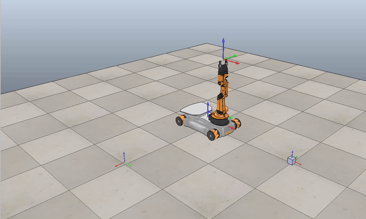
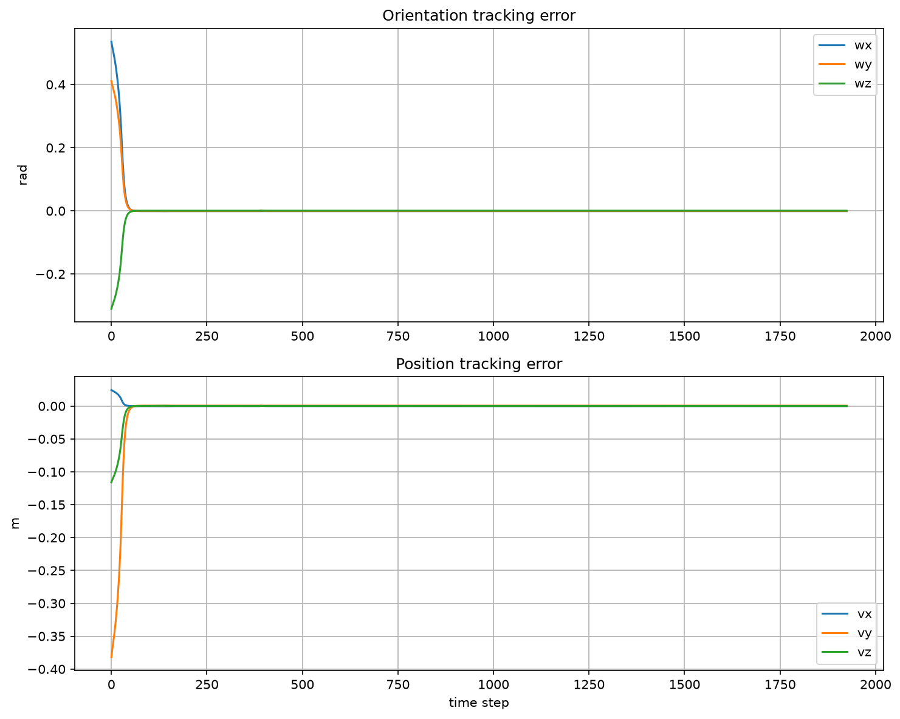
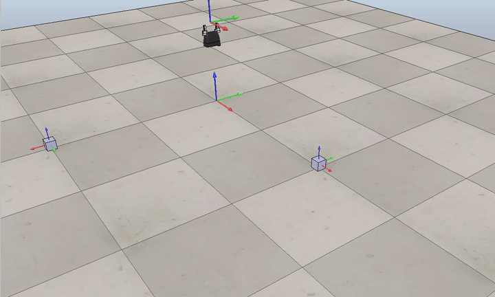

# Mobile Manipulation in CoppeliaSim

**UC San Diego MAE 204 · Mobile Robot Final Project**

A mobile manipulator follows a pick-and-place reference trajectory using task-space feedback control. The Python implementation generates an SE(3) end-effector path, computes wheel and arm commands, integrates the robot state, and exports CSV trajectories for CoppeliaSim playback.



**Watch the recordings:** [Mobile robot playback (MP4)](media/videos/mobile-manipulation.mp4) · [End-effector reference trajectory (MP4)](media/videos/arm-trajectory.mp4)

The short previews above and below are taken from the supplied CoppeliaSim recordings. The MP4 files contain the full recordings in a browser-friendly format.

## How the simulator works

| Stage | Implementation |
| --- | --- |
| Reference motion | `TrajectoryGenerator.py` creates eight screw-interpolated segments: approach, grasp, lift, transfer, release, and retreat. |
| Feedback | `FeedbackControl.py` combines a feedforward twist with PI pose-error feedback, then maps the command through the mobile manipulator Jacobian pseudoinverse. |
| State update | `Nextstate.py` integrates arm joints, wheels, and chassis odometry with actuator limits. |
| Experiment | `main.py` runs the loop, records the trajectory, and plots tracking error and Jacobian conditioning. |

The default run uses a 10 ms step, `Kp = 15 I`, `Ki = 0.1 I`, and the **new-task** cube placement configured in `main.py`. The saved run contains 1,926 reference and robot-state rows. The condition-number plot is a measure of Jacobian conditioning; lower values are better.



## Run the Python simulation

Use Python 3.11 or 3.12 from the repository root:

```bash
python -m venv .venv
# Activate .venv first: source .venv/bin/activate on macOS/Linux,
# or .venv\Scripts\Activate.ps1 in Windows PowerShell.
python -m pip install -r requirements.txt
python main.py
```

`main.py` writes `data/trajectory.csv`, `data/overall_trajectory.csv`, `data/tracking-error.png`, and `data/jacobian-condition.png`. It also opens the plots interactively. The CSVs and selected figures in this repo are examples from a verified run; rerunning the scripts replaces the CSVs.

For individual components, `python TrajectoryGenerator.py` writes the reference path and `python Nextstate.py` writes a 100-step state-propagation example to `data/state.csv`.

The videos were recorded in CoppeliaSim Scene 8 (end-effector trajectory) and Scene 6 (mobile manipulator playback). CoppeliaSim and its scene files are separate from this repository; running the Python code alone generates the CSV and plots, not the videos.

## Explore the results

| Scenario | Tracking error | Jacobian conditioning |
| --- | --- | --- |
| Current verified run | [Plot](media/plots/current-run-tracking-error.png) | [Plot](media/plots/current-run-jacobian-condition.png) |
| Best-case recording | [Plot](media/plots/tracking-error-best.png) | [Plot](media/plots/manipulability-best.png) |
| Oscillation experiment | [Plot](media/plots/tracking-error-oscillation.png) | [Plot](media/plots/manipulability-oscillation.png) |
| New-task recording | [Plot](media/plots/tracking-error-new-task.png) | [Plot](media/plots/manipulability-new-task.png) |



`data/trajectory.csv` stores a 3×3 rotation matrix, position, and gripper flag per row. `data/overall_trajectory.csv` and `data/state.csv` store chassis pose, five arm angles, four wheel angles, and the gripper flag. Each row has 13 values, matching the CoppeliaSim CSV playback format.

The project uses the `modern_robotics` Python library for rigid-body kinematics. The course assignment handout and CoppeliaSim scene assets are not part of the current repository.
